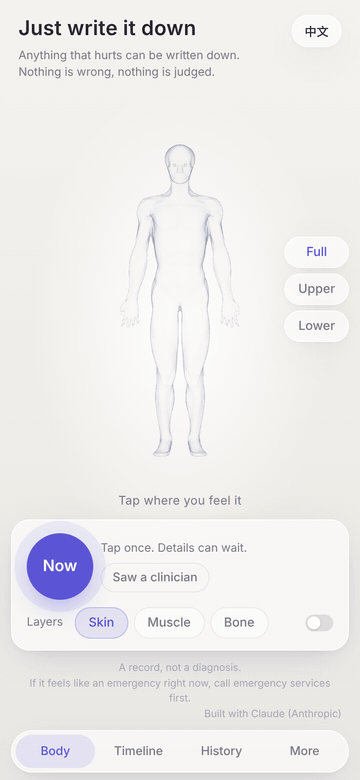
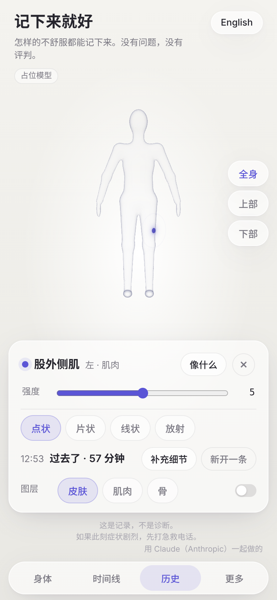
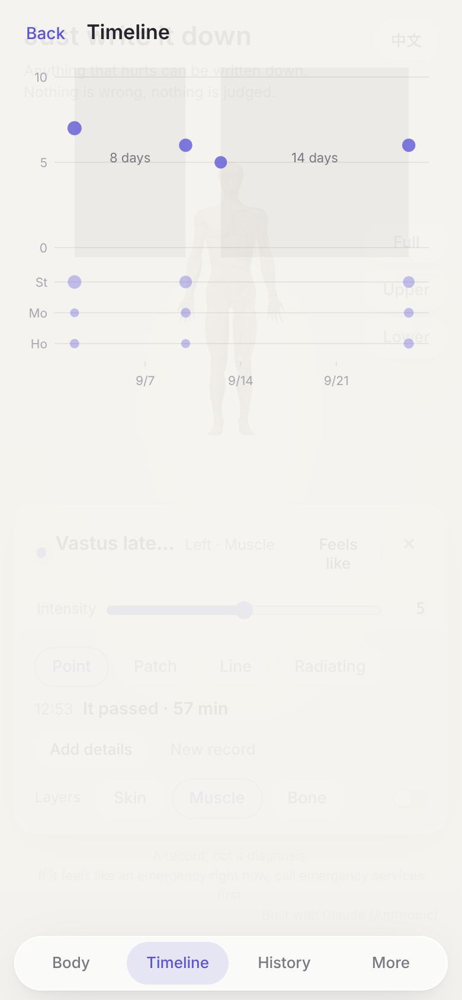
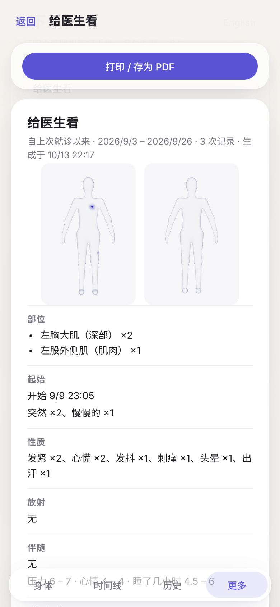
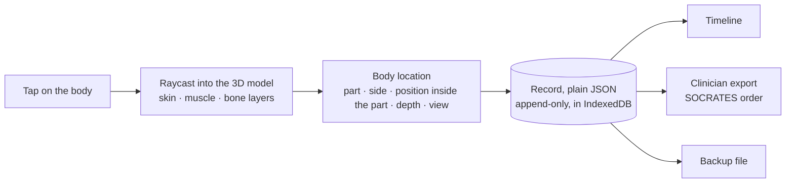

# BodyMap — tap where it hurts on a 3D body, keep a record a doctor can read

[](https://github.com/Lyrapower/bodymap/actions/workflows/ci.yml) [](https://github.com/Lyrapower/bodymap/actions/workflows/dco.yml)

**[▶ Open the live demo](https://lyrapower.github.io/bodymap/)** (best on a phone) · records never leave your device. If it helps you or someone you care for, a ⭐ helps other people find it.

<p align="center"></p>

```
git clone https://github.com/Lyrapower/bodymap && cd bodymap/app
npm install
npm run dev -- --host      # open the printed Network address on your phone
```

**Anything that hurts can be written down. Nothing is wrong, nothing is judged.**
**怎样的不舒服都能记下来。没有问题，没有评判。**

## Why

Pain is hard to put into words, and harder to remember accurately a week later in a doctor's office. BodyMap lets you tap the spot on a 3D body, say what it feels like and how long it lasted. Over weeks the records become something a clinician can read in one page, and something you can look back on yourself.

*A record, not a diagnosis.* 这是记录，不是诊断。 BodyMap does not diagnose and is not a medical device.

**Who it is for:** people who find pain hard to put into words. Children and older people. People living with something long-term. People who see doctors rarely and don't know which door. Anyone who has been told "we can't find anything" and knows it is still real.

## What it does

- **Mark on a 3D body**, by part and depth (skin, muscle, bone, deep). Point, patch, line or radiating. 418 named parts, left and right.
- **Record what it feels like** with plain words (McGill vocabulary) and a 0–10 intensity. Start time; end time when it passes.
- **One tap when it happens.** Details can wait.
- **Body & mind on one timeline.** Stress, mood, sleep, optional on every record.
- **Two exports.** For your clinician: since your last visit, in the order clinicians are trained to read (SOCRATES), with an "already checked" column. For you: the whole line, gaps and all.
- **Who to see.** When you ask, a transparent lookup lists where people with records like yours usually start. Two or three doors, never one; emergency last.
- **Yours.** Everything stays on your device. Export a backup file whenever you like. No account, no server, no analytics.
- 中文 / English.

<p align="center">
  
  
  
</p>

## How it works



A location is stored relative to the body part (its left/right side and a position inside the part's box), not as screen or world coordinates, so a mark lands on the same spot when you turn the body, change layers or open the record later. A tap on the skin is named by the part underneath it; a tap on a thin wrapping (fascia, bursa, tendon sheath) is named by the muscle or bone right behind it.

## The body model

The 3D body is derived from [Z-Anatomy](https://github.com/Z-Anatomy) (itself from BodyParts3D), CC BY-SA 4.0. `assets/model/export_zanatomy.py` exports it with Blender into one 12.4 MiB `body.glb`: 573 muscle parts (with their fascia and tendon sheaths), 222 bone parts and a skin shell, about 506k triangles. [`assets/model/CHANGES.md`](assets/model/CHANGES.md) records every change made to the model.

## Run

```
cd app
npm install
npm run dev            # open on a phone: npm run dev -- --host
```

Open it in Safari on a phone and add it to the home screen. The records stay in the browser on that device and never leave it.

## Tests

```
node core/tests/run.mjs                      # data rules, exports, routing, no words of judgement in the strings
cd app && npm run build && npm test          # types, unit tests
npm run e2e && npm run e2e:d1                # real browser on a phone viewport: taps, forms, storage, exports, 1000-record and bad-import cases
npm run e2e:webkit                           # the same in WebKit (Safari's engine), with touch input; needs WebKitGTK + WebKitWebDriver
```

## Data format

Records are plain JSON. See [`core/schema/README.md`](core/schema/README.md). The format is versioned and append-only: an edit writes a new record that `supersedes` the old one, and a backup file carries every version. Deleting a record (the only non-append action) asks first and removes all of its versions.

## Roadmap

- Faster on older phones: draw each layer as one mesh instead of one per part
- An organ layer, so "deep" marks have something to land on
- More languages for the body part names and the exports
- Works offline after the first visit (a service worker; today it needs the network to load)

## Contributing

Issues and pull requests are welcome; issues labelled [`good first issue`](https://github.com/Lyrapower/bodymap/labels/good%20first%20issue) are small and self-contained. Please read [CONTRIBUTING.md](CONTRIBUTING.md) first: every commit is signed off (DCO), and two rules are not negotiable (it records, it never judges; records are points, never interpolated).

## License

Code: [AGPL-3.0](LICENSE). Body model: CC BY-SA 4.0, see [ATTRIBUTION.md](ATTRIBUTION.md). Contributions: see [CONTRIBUTING.md](CONTRIBUTING.md) (DCO).

Built with Claude (Anthropic).
